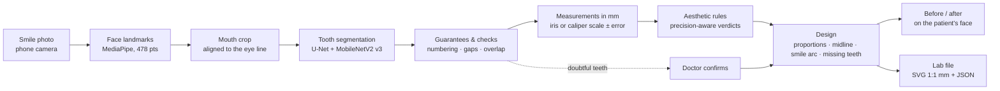

# Digital Smile Design — AI-assisted smile analysis and design for a dental clinic

A complete Digital Smile Design (DSD) system built as a deep-learning graduation project for a real dental clinic. From
one smile photo of the patient it finds the face and the six upper front teeth, measures them, checks them against
aesthetic rules, proposes a design (including missing or broken teeth), shows the **patient's own face before and
after**, and produces a lab file at true size. The doctor confirms anything the system is not sure of.

- **App (installable PWA, phone/tablet):** `https://alnsyryfwzy55-source.github.io/digital-smile-design-ai/`
- **Annotation tool:** `…/annotate/` · **Optional analysis server:** `server/` (free Hugging Face Space, `deploy/`)
- Arabic version of this page: [README.ar.md](README.ar.md)

## How it works



Everything runs in the browser (ONNX Runtime Web + MediaPipe). The optional server runs the same Python core as a second
opinion: when phone and server disagree on a tooth, the doctor is asked.

## Why the outputs can be trusted

Reliability is built in layers, each tested, instead of trusting one network:

| Layer | What it guarantees | Evidence (tests in this repo) |
|---|---|---|
| Structural guarantees | no tooth outside the mouth, no overlap, one region per tooth, strict FDI order (13 12 11 21 22 23) via exact dynamic programming | holds on all 43 labelled photos, also when the network swaps classes (Dice 0.63 → 0.94) |
| Gap check | a "tooth" much darker than its neighbours is a gap the network filled in | 0 false alarms on 258 real teeth, 84/86 erased teeth caught |
| Numbering safety net | a tooth-sized empty space between neighbours, or one tooth split in two, is sent to the doctor | erased lateral caught 84/86 with model v3; 2 flags on 258 intact teeth |
| Lower-tooth check | a lower incisor labelled as an upper one is rejected | 6/6 errors caught on internet drafts, no correct tooth flagged |
| Measurement precision | every verdict knows its error (photo resolution and model grid): a difference smaller than the error is "cannot be judged from this photo", not a false warning | app and Python agree on 300/300 random cases |
| Confidence threshold | a tooth below 0.95 confidence must be confirmed by the doctor | calibrated: catches 43/47 wrong teeth, asks about 3/257 correct ones |
| Model acceptance gate | a new model replaces the current one only if it is at least as good on 10 measures | rejects blurred, gap-painting, over-confident and wrong-interface models |
| Doctor in the loop | nothing is approved before doctor review; disagreements and doubtful teeth block approval | end-to-end browser tests |

**Why no general AI (LLM) in the loop:** a vision LLM was tested as a reviewer of tooth labels. It marked visible teeth as
hidden, approved shifted numbering and misjudged children vs adults. Adding it would add silent errors, so the system
relies on the checks above, which are measurable.

## Results

Tooth model (7 classes, input 384×384, 16.5 MB ONNX). Same photos, same measures (`training/MODEL_CARD.md`):

| | v2 | **v3 (in use)** |
|---|---|---|
| Dice, labelled retractor test photos | 0.956 | **0.955** |
| Dice, held-out real smiles | 0.888 | **0.927** |
| Tooth painted into a gap | 80–88% | **0%** |
| Dice in the browser (WASM) | 0.959 | **0.960** |
| Inference, CPU | 81 ms | **77 ms** |

Simulation (the "after" image), measured on 129 rebuilt-tooth cases against the real tooth (`app/test/sim_bench/`):
no black remnants (1.9% → 0.0%), seams inside teeth 3× lower, edges as soft as real teeth, whitening never burns detail
beyond what the photo itself has, no blue cast in highlights.

## Repository

```
docs/        the app as served (GitHub Pages): HTML/JS, AI runtimes in docs/vendor, model teeth_unet_v2.onnx (= v3)
app/         app sources, build script (app/build.py) and tests (unit, browser end-to-end, simulation benchmark)
core/dsd/    the Python core: measurements with error, rules, design, validation, lab export, numbering, checks
server/      analysis service + HTTP API (standard library) + FastAPI wrapper, with tests
deploy/      free deployment on Hugging Face Spaces (Dockerfile, model fingerprint check)
training/    v3 training notebook, internet-draft pipeline, review tools, acceptance gate, calibration, model card
data/        the labelled training set smile_teeth_v2 (CC BY 4.0) and its sources
research/    generative "after" image experiments (not used in the app; future work)
```

## Run it

```bash
# app (rebuild docs/ after changing app/src)
python app/build.py && python -m http.server -d docs 8000        # open http://localhost:8000

# tests
cd core && python -m pytest -q tests                               # 29: core, parity with the app, real photos
cd server && python -m pytest -q tests                             # 5: service and HTTP API end to end
cd app && node test/core.test.js && node test/smile.test.js        # 39 unit tests
python app/test/e2e_real.py OUT photo.jpg                          # full app in Chrome with the real models
python app/test/sim_bench/prep.py && node app/test/sim_bench/run.js && python app/test/sim_bench/metrics.py

# analysis server
cd server && python http_api.py --port 8800                        # POST /api/analyze, GET /api/health

# a new model: accept or reject
python training/accept_model.py new_model.onnx --smiles reviewed.zip
```

Training (`training/v3/train_v3.ipynb`) and the internet-draft pipeline (`training/bootstrap/run_in_colab.ipynb`) run
on free Google Colab GPUs; both notebooks are self-contained.

## Data, licences, privacy

- Training labels: Roboflow Universe datasets under CC BY 4.0 (details in `data/README.md`).
- Real smiles for v3: openly licensed Openverse photos (sources recorded per photo), drafted automatically, reviewed;
  kept private and not redistributed (some licences forbid derivatives).
- Patient photos never leave the doctor's device unless the doctor enables the server; the server analyses in memory
  and stores nothing. Backups are encrypted (AES-256).

## Limits

- A decision-support tool for the dentist, not a diagnostic device; every proposal is reviewed and approved by the doctor.
- The real-smile test labels were reviewed by an AI, not yet by a clinician; a clinician-reviewed test set and caliper
  measurements on clinic patients are the next validation step.
- The canine at the end of the arch is the weakest tooth (Dice ≈ 0.86–0.89 on smiles).
- Generative (photorealistic) "after" images are research only (`research/generation`).
